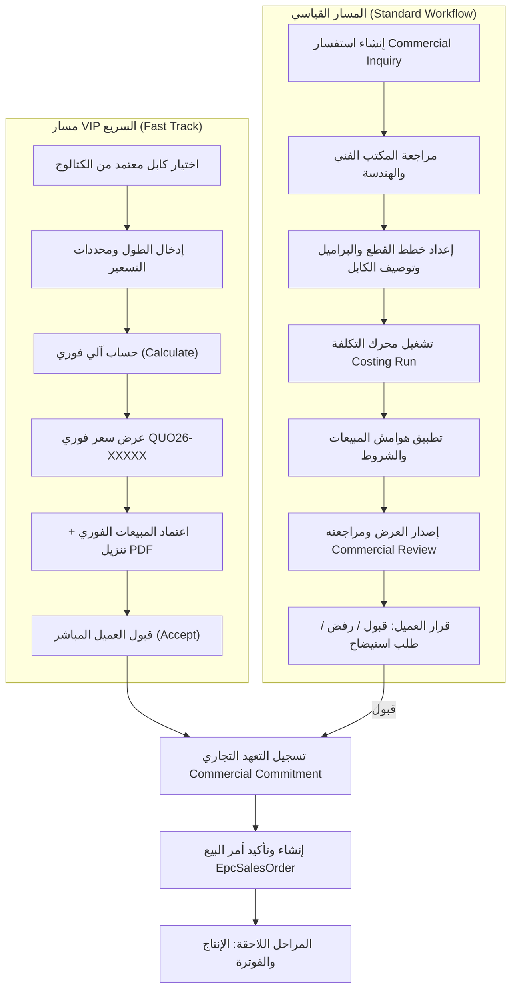
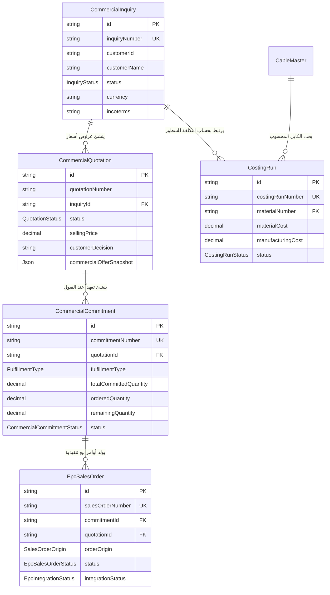

# سياق مشروع منصة Energya Connect (PROJECT_CONTEXT.md)

> **وثيقة مرجعية شاملة ومحدثة للمهندسين والمساعدين الأذكياء (AI Agents).**  
> جميع المعلومات المذكورة هنا مستخرجة ومحققة مباشرة من الكود المصدري للمشروع. أي معلومة لم يتم الجزم بها بنسبة 100% مُعلّمة بـ `(غير مؤكد)` مع ذكر السبب الهندسي.

---

## 1. نظرة عامة على المشروع (Project Overview)

### ما هو Energya Connect؟
منصة تجارة صناعية B2B متكاملة ومتخصصة في صناعة الكابلات، تربط عملاء الشركة والشركاء التجاريين (مثل شركة Eland Cables في المملكة المتحدة) بالأقسام الهندسية والتجارية والمالية وإدارة سلاسل الإمداد لمجموعة إنرجيا. تتيح المنصة أتمتة دورة حياة الكابلات من التهيئة الفنية، حساب التكاليف، تسعير المعادن اللحظي (نحاس وألومنيوم)، إصدار عروض الأسعار، إدارة التعهدات، وتحويلها إلى أوامر بيع تنفيذية.

### المستخدمون والأدوار (Users & Roles)
1. **العملاء (Customer Users)**: ممثلو الشركات المشترية (مثل David Smith من Eland Cables)، يمتلكون حق الوصول الحصري لبوابة العميل لاستعراض الكتالوج المعتمد، إدخال الاستفسارات، مراجعة عروض الأسعار، وتأكيد التعهدات وأوامر البيع.
2. **مديرو وممثلو المبيعات (Sales Managers / Agents)**: يتابعون الاستفسارات التجارية، يراجعون العروض المحسوبة، يعتمدون هوامش الربح والشروط التجارية، ويصدرون العروض للعملاء.
3. **المكتب الفني (Technical Office Engineers)**: مسؤولون عن التحقق الهندسي، مطابقة الكابلات بالمعايير، إنشاء ومراجعة خطط البراميل وخطط القطع، وحل نزاعات خلطات التصنيع (BOM Conflicts).
4. **مهندسو التكاليف (Costing Engineers)**: إدارة وحساب تكلفة الخامات، تكاليف التشغيل المباشرة، نسب الهالك، ومصاريف الشحن والتفريغ.
5. **مديرو المشتريات (Procurement Managers)**: تحديث ومراقبة أسعار الخامات الأساسية وأسعار معادن بورصة لندن للمعادن (LME).
6. **الإدارة والمسؤولون (System Administrators)**: إدارة هويات المستخدمين، مصفوفة الصلاحيات (RBAC)، مجموعات الأمان، وتتبع سجلات التدقيق (Audit Trails).

### مسارا الاستفسار (Inquiry Lifecycles)



1. **مسار كبار العملاء السريع (VIP Fast Track)**:
   - **الهدف**: اختصار زمن التسعير من أيام إلى ثوانٍ للعملاء المعتمدين للكابلات النمطية.
   - **الخطوات**: اختيار الكابل من الكتالوج المعتمد -> إدخال الطول (مثل 500 متر) وتسامح السطر وأسعار المعادن (نحاس وألومنيوم) والشروط اللوجستية (مثل تسليم موقع DAP Doncaster) -> الضغط على `Calculate` -> إنشاء مسودة عرض سعر فوري `CommercialQuotation` -> مراجعة واعتماد المبيعات -> ظهور العرض فورياً للعميل كملف تجاري رسمي PDF (بصلاحية 48 ساعة وسعر DAP) -> قبول العميل الفوري -> إنشاء تعهد تجاري مباشر وأمر بيع مؤكد.
2. **المسار القياسي المتكامل (Standard Workflow)**:
   - **الهدف**: استفسارات المشاريع الكبرى والمواصفات المخصصة والتصنيع حسب الطلب (MTO).
   - **الخطوات**: تسجيل استفسار تجاري `CommercialInquiry` بحالة `DRAFT` ثم `SUBMITTED` -> مراجعة هندسية في المكتب الفني `TECHNICAL_REVIEW` لربط الكابل بـ `CableMaster` والتحقق من الخلطة الفنية `CableBomLine` -> إعداد خطة القطع وخطة البراميل `V2DrumPlan` -> تشغيل دورة التكاليف `CostingRun` لتقييم الخامات والمصنعيات -> انتقال الاستفسار إلى `READY_FOR_COMMERCIAL` -> إعداد وإصدار عرض السعر `CommercialQuotation` بحالة `ISSUED` -> استلام قرار العميل (Acceptance, Rejection, أو Clarification Request).

### دورة ما بعد قرار العميل (Commitment to Sales Order)
- بمجرد موافقة العميل (`ACCEPTED`)، ينشئ النظام سجلاً تعاقدياً ملزماً يُدعى **التعهد التجاري (Commercial Commitment)** يحدد الكمية المحجوزة (`totalCommittedQuantity`) ونمط الاستيفاء (`FulfillmentType: DIRECT_ORDER` أو `SALES_AGREEMENT`).
- من التعهد يتم توليد **أمر البيع (EpcSalesOrder)** بحالة `CONFIRMED`.

### المراحل غير المنفذة والواجهات التجريبية (Prototype & Stub Stages)
- **متابعة الإنتاج الفعلي (Production Monitoring)**: الشاشة `/internal/production` وواجهات ربط نظام الورشة Advaris MES (مثل `GET /api/advaris/mes-status`) هي واجهات تجريبية (Stubs/Simulation) ولا تعكس بيانات مصنع حية حتى الآن.
- **الفوترة والتحصيلات (Invoicing & Financial Collections)**: واجهات الفواتير للعميل (`/customer/invoices`) وشاشة المالية (`/internal/finance`) تعرض بيانات افتراضية/تجريبية وليست متصلة بنظام بنكي أو دفاتر حسابات حقيقية.
- **التكامل مع Microsoft Dynamics 365 (D365 F&O)**: المسار `GET /api/d365/sync-status` يعيد صراحة `{ connected: false, status: 'NOT_CONNECTED' }`، وتظل حالة التكامل لكافة أوامر البيع والتعهدات بقيمة `NOT_SENT`.

---

## 2. المعمارية الهندسية ومسار الترحيل (Architecture & Migration)

### النظام الحالي (Legacy Express Monolith)
- **الخادم**: Node.js + Express 4 في `server.ts` على المنفذ `3847`.
- **الواجهة الأمامية**: تطبيق صفحة واحدة (SPA) مبني بـ React 19 + TypeScript + Vite + Tailwind CSS.
- **طبقة البيانات**: PostgreSQL مدار عبر Prisma ORM (`prisma/schema.prisma`).
- **المعالجة**: في بيئة التطوير، يعمل خادم Express كخادم API ويدمج وسيط تطوير Vite في نفس الوقت لخدمة الواجهة.

### النظام المستهدف قيد الترحيل (Target NestJS Backend)
- **الموقع**: مجلد مستقل داخل المستودع باسم `energya-backend/`.
- **التقنيات**: NestJS 12 مع بنية معيارية حديثة (Clean Architecture: Controllers, Services, Repositories, DTOs مع التحقق عبر `class-validator`).
- **المنفذ**: المنفذ الافتراضي `3000`.
- **قاعدة البيانات**: يشارك نفس المخطط ومحرك Prisma عبر الإشارة إلى `../prisma/schema.prisma`.

### آلية التوجيه والبروكسي الهجين (Vite Hybrid Proxy)
- في ملف `vite.config.ts`، يتم توجيه الطلبات عبر البروكسي بناءً على جدول المطابقة الموثق في `scripts/parity/nestRoutes.mjs`:
  - المسارات التي تم ترحيلها واختبار مطابقتها (المراحل 0، 1، 2a مثل `/api/auth`، `/api/admin/*`، ومسارات قراءة الماستر داتا `/api/master/*`) يتم تحويلها إلى خادم NestJS على المنفذ `:3000`.
  - كافة المسارات التجارية، التسعير، الاستفسارات، وأوامر البيع المتبقية تستمر بالذهاب إلى خادم Express القديم على المنفذ `:3847`.
- في بيئة التشغيل السحابية الموحدة (مثل Vercel)، يتم تجميع خادم Express بالكامل مع الواجهة كدالة Serverless ذاتية الاحتواء في `api/index.js`.

---

## 3. خريطة المجلدات والملفات الكبيرة والخطرة (Folder Map & Risky Files)

### هيكل المجلدات الرئيسي
```
H:\Eland-Cables\
├── api/                    مخرجات دالة Vercel Serverless (api/index.js)
├── docs/                   التوثيق الهندسي ومستندات الترحيل وقرارات التصميم
│   ├── briefs/             قوالب مواصفات الفيتشرات (quotation.md, orders.md)
│   ├── MIGRATION/          خطة الترحيل ومصفوفات مطابقة المسارات وتقارير المراحل
│   └── vip-journey/        توثيق تجارب رحلة VIP السريعة وملاحظات الاعتمادات
├── energya-backend/        خادم NestJS الجديد قيد الترحيل
│   └── src/
│       ├── auth/           مصادقة Nest وتوليد الـ JWT
│       ├── admin-*/        إدارة المستخدمين والعملاء
│       ├── master-data/    بيانات الكابلات والخامات والبراميل
│       └── shared/domain/  نسخ المنطق الحسابي المتطابقة مع القديم
├── prisma/                 schema.prisma (المصدر الوحيد للحقيقة) وملفات seed
├── scripts/                سكربتات الترحيل، فحص التطابق، وبدء النشر
└── src/                    كود المشروع الحالي (Express Backend + React Frontend)
    ├── app/                توجيه الشاشات وقوائم التنقل (shellRoutes, customerPortalNav)
    ├── components/         مكونات الواجهة React 19
    │   ├── customer/       شاشات بوابة العميل (Dashboard, Inquiries, Orders, Commitments)
    │   ├── internal/       شاشات البوابة الداخلية (TechnicalOffice, CostingHub, SalesQuotations)
    │   └── inquiry-quotation/ تفاصيل وعروض الأسعار وحاسبة البراميل
    ├── domain/             المنطق الرياضي والهندسي الخالص (حساب البراميل، تحويل الخامات)
    ├── server/             مسارات وخوادم Express القديمة والمستودعات وقواعد الصلاحيات
    └── services/           طبقة استدعاء الـ APIs من الواجهة
```

### قائمة الملفات الكبيرة والحساسة (Hotspots & Dangerous Files)
> [!CAUTION]
> هذه الملفات تحتوي على آلاف الأسطر البرمجية وتتشابك مع مفاصل النظام، أي تعديل عشوائي فيها يؤدي إلى عطل واسع:

1. `src/components/inquiry-quotation/CommercialInquiryDetail.tsx` (3,470 سطراً):
   - **الخطورة**: يمثل عصب شاشة عرض تفاصيل الاستفسار وعروض الأسعار في البوابة التجارية والمكتب الفني. يحتوي على إدارة حالة معقدة جداً، واجهات إدخال خطط البراميل، موافقات التسعير، وزر إصدار العرض التجاري وتنزيل PDF.
2. `src/server/commercialRepository.ts` (2,284 سطراً):
   - **الخطورة**: مستودع البيانات الأضخم في النظام القديم؛ يحتوي على كافة استعلامات Prisma للاستفسارات، ربط الخطوط، وحساب مراحل التكلفة والانتقال بين حالات الاستفسار.
3. `src/server/v2QuotationRepository.ts` (~1,500 سطراً):
   - **الخطورة**: المسؤول عن حساب وتوليد عروض الأسعار V2 وتخزين لقطات التكلفة والعروض الفنية وتطبيق قرارات العميل.
4. `src/server/rbac.ts` (1,123 سطراً):
   - **الخطورة**: المحرك المركزي للتحقق من أذونات المستخدمين الداخليين ومنع العملاء من تعديل بيانات الماستر داتا.
5. `src/server/customerScope.ts` (~380 سطراً):
   - **الخطورة**: خط الدفاع الأول لعزل بيانات العملاء؛ يضمن أن العميل لا يرى أو يعدل إلا الاستفسارات والتعهدات الخاصة بمؤسسته حصراً.

---

## 4. نموذج البيانات والجداول الأساسية (Core Data Model)

تعتمد المنصة على خمسة كيانات رئيسية مترابطة في `prisma/schema.prisma`:



### العلاقات الهندسية الرئيسية:
1. `CommercialInquiry` (سطر 702): يحتوي على `inquiryNumber` الفريد ومعلومات العميل والشروط التجارية المبدئية، ويرتبط بأسطر الاستفسار `CommercialInquiryLine` وعروض الأسعار `CommercialQuotation`.
2. `CommercialQuotation` (سطر 1092): يرتبط بالاستفسار عبر `inquiryId`. يحتفظ بنسخ العرض (`versionNo`)، السعر الإجمالي (`sellingPrice`)، لقطات العرض الفني والتجاري (`technicalOfferSnapshot`، `commercialOfferSnapshot`)، وقرار العميل (`customerDecision: ACCEPTED | REJECTED | CLARIFICATION_REQUESTED`).
3. `CommercialCommitment` (سطر 1241): الجسر الرابط بين العرض المعتمد وأوامر البيع. يرتبط بـ `quotationId` ويوثق نمط الاستيفاء (`DIRECT_ORDER` أو `SALES_AGREEMENT`) والكميات الإجمالية والمطلوبة والمتبقية.
4. `EpcSalesOrder` (سطر 1282): أمر البيع التنفيذي النهائي، يرتبط بالتعهد عبر `commitmentId` وبالعرض عبر `quotationId`. يحمل حالة التشغيل (`status: CONFIRMED`) وحالة إرساله للـ ERP (`integrationStatus: NOT_SENT`).
5. `CostingRun` (سطر 502): السجل الحسابي التفصيلي لتكلفة الكابل المعتمد على خلطة التصنيع `CableBomLine` وأسعار الخامات اللحظية `RawMaterialPrice`.

---

## 5. الهوية والصلاحيات وعزل العميل (Identity, RBAC & Customer Isolation)

### كيفية عزل العميل عن البيانات الداخلية (Data Isolation Enforcement)
- **عزل على مستوى الـ API والـ Middleware**: يتم فحص نوع المستخدم (`actor.userType === 'customer'`) بواسطة توابع التحقق في `src/server/customerScope.ts`:
  - الدالة `assertCustomerBusinessScope(actor, targetCustomerId)`: تمنع أي عميل من الوصول لأي استفسار أو أمر بيع لا يتطابق رقم `customerId` الخاص به مع معرف الشركة المسجل على حسابه، وترمي فوراً خطأ `403 FORBIDDEN`.
  - الدالة `applyCustomerInquiryScope(...)`: تقوم بتصفية استعلامات Prisma تلقائياً بحيث يعود استعلام `findMany` بالبيانات التابعة لحساب العميل حصراً.
- **حظر تعديل الماستر داتا الداخلي**:
  - في `src/server/rbac.ts`، تقوم دوال مثل `assertCanWriteCableMaster` و `assertCanImportMasterData` بفحص فوري:
    ```typescript
    if (actor.userType === 'customer') {
      throw issue('UNAUTHORIZED', 'Customer users cannot create or modify Master records.');
    }
    ```
- **حجب الحقول السرية (Cost Redaction)**:
  - عند استرجاع بيانات الكابلات والمنتجات بواسطة العميل، يتم تنقية الاستجابة عبر حذف بنود التكلفة المصنعية (`costPerKm`، `marginRate`، تفاصيل خلطات التصنيع الداخلية) ولا تظهر له سوى الأسعار النهائية المعتمدة.

### حسابات مستخدمي التجارب الافتراضية (Demo Personas)
يتم زراعة هويات تجريبية في قاعدة البيانات عبر `src/server/identityService.ts` تُدار عبر متغير بيئي محكوم `ALLOW_DEMO_USERS=true`:
- حساب عميل معتمد: `david.smith@elandcables.com` (مرتبط بمؤسسة Eland Cables).
- حساب إدارة المبيعات: `sales@energya.com` (دوره `SALES_MANAGER`).
- حساب المكتب الفني: `technical@energya.com` (دوره `TECHNICAL_OFFICE`).
- حساب هندسة التكاليف: `costing@energya.com` (دوره `COSTING_ENGINEER`).
- حساب إدارة المشتريات: `procurement@energya.com` (دوره `PROCUREMENT_MANAGER`).
- حساب مسؤول النظام: `admin@energya.com` (دوره `ADMIN`).

---

## 6. خريطة الـ API الرئيسية (API Endpoints Map)

| المجال الوظيفي | المسارات الرئيسية (Endpoints) | الوصف الهندسي |
|---|---|---|
| **المصادقة والهوية** | `POST /api/auth/login`<br>`POST /api/auth/refresh`<br>`GET /api/auth/me` | تسجيل الدخول، تجديد توكن الجلسة، والتحقق من المستخدم الحالي |
| **إدارة النظام والمستخدمين** | `GET /api/admin/users`<br>`GET /api/admin/roles`<br>`GET /api/admin/customers` | إدارة حسابات الموظفين والعملاء ومجموعات الأمان |
| **البيانات المرجعية (Master Data)** | `GET /api/master/cables`<br>`GET /api/master/raw-materials`<br>`GET /api/master/boms`<br>`GET /api/master/drums` | قراءة كتالوج الكابلات المعتمد، أسعار المعادن والخامات، خلطات التصنيع، وقوائم البراميل |
| **استفسارات العملاء (Inquiries)** | `GET /api/inquiries`<br>`POST /api/inquiries`<br>`GET /api/inquiries/:id`<br>`POST /api/v2/inquiries/calculate` | إدارة الاستفسارات وحساب التسعير الآلي السريع لمسار VIP |
| **عروض الأسعار (Quotations)** | `GET /api/quotations/:id`<br>`POST /api/quotations/:id/approve`<br>`POST /api/quotations/:id/issue`<br>`POST /api/quotations/:id/customer-decision` | مراجعة العرض، اعتماده تجارياً، إصداره للعميل، وتسجيل قبول أو رفض العميل |
| **التعهدات وأوامر البيع** | `GET /api/commercial-commitments`<br>`POST /api/commercial-commitments`<br>`GET /api/sales-orders`<br>`POST /api/sales-orders` | إنشاء التعهد التجاري وتوليد وتأكيد أمر البيع الرسمي |
| **التكاليف والمكتب الفني** | `GET /api/costing/runs/:id`<br>`POST /api/technical-office/cable-mapping` | متابعة تقييم تكلفة بنود الاستفسار ومطابقة المواصفات الفنية |
| **المساعد الذكي (AI Assistant)** | `POST /api/ai/assistant` | التفاعل مع مساعد الذكاء الاصطناعي لتقديم المشورة الفنية والتجارية |
| **تكامل الأنظمة الخارجية** | `GET /api/d365/sync-status`<br>`GET /api/advaris/mes-status` | واجهات اختبار استعلامات التكامل مع ERP و MES (Stubs) |

---

## 7. كتالوج الشاشات والواجهات (Screens Catalog)

### شاشات بوابة العميل (Customer Portal)
- **الرئيسية (Dashboard)**: ملخص نشاط العميل والاستفسارات الجارية وأحدث الإشعارات.
- **كتالوج المنتجات (Products)** (`/customer/products`): تصفح كابلات إنرجيا المعتمدة والبحث حسب الجهد والعوازل.
- **استفساراتي (My Inquiries)** (`/customer/inquiries`): إنشاء الاستفسارات ومتابعة حالتها وحساب تسعير VIP.
- **عروض الأسعار (Quotations)**: تصفية الاستفسارات بحالة `QUOTED` لمراجعة العروض والـ PDF واتخاذ قرار القبول/الرفض.
- **أوامر البيع (Sales Orders)** (`/customer/sales-orders`): استعراض أوامر البيع المؤكدة ومراحل الاستيفاء والتعهدات.
- **مكتبة الوثائق الفنية (Documents / TDS)** (`/customer/documents`): استعراض وتنزيل المواصفات الفنية المعتمدة للكابلات.
- **الدعم والمساعدة (Support Center)** (`/customer/support`): فتح تذاكر الشكاوى والملاحظات الفنية.

### الشاشات المخفية والتجريبية للعميل (Hidden & Experimental Customer Screens)
- **حاسبة البراميل للعميل (Customer Drum Optimizer)** (`/customer/drum-optimizer`): الشاشة تعمل ومكتملة، لكن تم حجبها برمجياً من قائمة التنقل الرئيسية للعميل؛ لا يمكن الوصول إليها إلا عبر كتابة الرابط المباشر (راجع `FIND-2A-05`).
- **كشف الحساب (Customer Statement)** (`/customer/statement`): غير ظاهرة في القائمة المعتمدة للعميل (مخفية تجريبياً).
- **الفواتير (Invoices)** (`/customer/invoices`): واجهة نموذجية (Prototype) غير مكتملة الربط الحسابي.
- **تتبع الشحنات (Shipment Tracking)** (`/customer/shipments`): مخفية من القائمة العلوية وتنتظر تفعيل موديول الشحن المتكامل.

### شاشات البوابة الداخلية (Internal Portal)
- **المكتب الفني (Technical Office)** (`/internal/technical-office`): مراجعة مطابقة الكابلات واعتماد خطط البراميل والقطع.
- **إدارة بارامترات الكابلات (Cable Configurator Hub)** (`/internal/cable-parameters`): ضبط المعايير والمحددات الهندسية.
- **مركز التكاليف (Costing Hub)** (`/internal/costing`): تشغيل محرك التكلفة وحسابات الخامات.
- **عروض الأسعار التجارية (Sales Quotations)** (`/internal/quotations`): مراجعة هوامش المبيعات واعتماد وإصدار العروض الرسمية.
- **أوامر البيع والتعهدات (Sales Orders & Fulfillment)** (`/internal/sales-orders`): إدارة دورة أوامر البيع واستيفاء التعهدات.
- **مركز إدارة الماستر داتا (Master Data Hub)** (`/internal/master-data`): رفع واستيراد وتعديل الكابلات والخامات والبراميل والـ BOMs.
- **إدارة النظام والأمان (Administration Hub)** (`/internal/administration`): إدارة المستخدمين، الصلاحيات، وسجلات التدقيق.
- **متابعة الإنتاج (Production Monitoring)** (`/internal/production`): شاشة تجريبية ومحاكاة لخطوط الإنتاج.
- **التحصيلات والمالية (Finance & Collections)** (`/internal/finance`): شاشة تجريبية للمراجعات المالية.

---

## 8. البيئة والنشر وحراس الإنتاج (Environments, Deployment & Production Guards)

### بيئات الاستضافة الحالية
1. **الاستضافة السحابية التشغيلية (Vercel)**:
   - التطبيق منشور حالياً ويعمل كدالة Serverless متكاملة عبر تجميع `server.ts` داخل ملف ذاتي التشغيل `api/index.js` مع ضبط ملف التهيئة `vercel.json` ومعالجة المسارات تلقائياً.
2. **بيئة الحاويات السابقة / التجريبية (Back4App Containers)**:
   - تم تجهيزها سابقاً بملف `Dockerfile` مع معالجة حدود الذاكرة (256MB) وحزم `app_dist`.
3. **بيئة Render (إن وُجدت)**:
   - تم توثيق إعداداتها في `docs/release/RENDER_SETUP_GUIDE.md` كخيار نشر سحابي بديل للحاويات.

### المتغيرات البيئية المطلوبة (Environment Variables - Names Only)
> [!IMPORTANT]
> لا يُكتب أي محتوى سري أو قيمة حقيقية في هذا التوثيق نهائياً. فيما يلي قائمة بأسماء المتغيرات فقط:
- `DATABASE_URL`: رابط الاتصال بقاعدة بيانات PostgreSQL السحابية (Neon / Postgres).
- `JWT_SECRET`: المفتاح المشفر لتوليد توكنات الجلسة (يجب ألا يقل عن 32 حرفاً في NestJS).
- `NODE_ENV`: بيئة التشغيل (`production` أو `development`).
- `PORT`: المنفذ الذي يستمع إليه الخادم (افتراضياً 3847 في Express و 3000 في Nest).
- `ALLOW_DEMO_USERS`: تفعيل زراعة المستخدمين التجريبيين (`true` أو `false`).
- `ADMIN_SEED_PASSWORD`: كلمة المرور المبدئية لمدير النظام عند تشغيل الـ Seed في بيئة الإنتاج.
- `DEMO_SALES_PASSWORD` / `DEMO_TECH_PASSWORD` / `DEMO_COSTING_PASSWORD` / `DEMO_CUSTOMER_PASSWORD`: متغيرات ضبط كلمات مرور المستخدمين التجريبيين.
- `GEMINI_API_KEY`: مفتاح خدمة Google Gemini AI المخصص لمساعد التسعير والاستفسارات الذكي.

### حراس الإنتاج الصارمة (Production Guards)
- **دالة `validateProductionAdminSeedPassword`**: ترفض تشغيل خادم الإنتاج إذا لم يتم توفير قيمة آمنة للمتغير `ADMIN_SEED_PASSWORD` عند طلب زراعة مسؤول النظام.
- **دالة `isDemoUserSeedAllowed`**: تمنع منعاً باتاً إنشاء أو إعادة تعيين كلمات سر الحسابات التجريبية في بيئة الإنتاج ما لم يتم التصريح بذلك عبر `ALLOW_DEMO_USERS=true`.
- **حارس حجب الأسرار `redactSecrets`**: يقوم تلقائياً بمسح أي حقول تحمل مسميات (password, token, secret, hash) قبل كتابة أي حدث تدقيق في جدول `AuditEvent`.

---

## 9. المشاكل المعروفة والديون الأمنية (Known Issues & Security Findings)

1. **الثغرة الأمنية الموثقة `SEC-MD-01` (تسريب بيانات الـ BOM والخامات للعميل)**:
   - **الواقع**: المساران `GET /api/master/boms` و `GET /api/master/raw-materials` يقومان بإرجاع كافة خلطات التصنيع الهندسية (4,822 سطراً) وكامل أسعار الخامات (74 خامة) لأي مستخدم يحمل دور `customer`؛ وذلك لأن دالة الفحص القديمة `assertCanViewMasterDataCatalog` تسمح للعميل فورياً بالقراءة.
   - **الحالة**: منقولة 1:1 في Phase 2a في Nest للحفاظ على تطابق الـ Parity وتنتظر قرار المالك بحجبها برمز `403`.
2. **الثغرة الأمنية الموثقة `SEC-MD-02` (المرفقات الهندسية متاحة للعامة بدون مصادقة)**:
   - **الواقع**: المسارات `GET /api/master/cables/:mat/attachments` و `GET .../attachments/:id` تعمل بدون أي توكن مصادقة (Public No Auth) ويتم استرجاع الملفات الثنائية لأي زائر.
   - **الحالة**: موثقة رسمياً وتنتظر قرار التقييد الهندسي.
3. **ديون اختبارات المرحلتين 1 و 2a (Deferred Tests)**:
   - تم تأجيل اختبارات عزل الاستفسارات متعددة المستأجرين (TEST 1-4 في `increment12b2_1.securityHardening.e2e-spec.ts`) كـ `it.todo` لتُنفذ أثناء ترحيل المرحلة 4 (Commercial & Inquiries).
   - تم تأجيل اختبارات تصدير إكسل العميل للمرحلة 2b، واختبارات حوكمة ونزاعات الـ BOM للمرحلة 2c.
4. **تنبيه `FIND-2A-06` (براميل الاختبار المتراكمة)**:
   - تراكمت سجلات براميل بأسماء عشوائية وتواريخ اختبار في قاعدة بيانات Nest نتيجة تشغيل اختبارات التكامل، وتحتاج لعملية تنظيف قبل العروض التجريبية المباشرة.

---

## 10. قاموس المصطلحات والمفاهيم (Glossary)

- **CR (Commercial Request / Inquiry)**: طلب العميل التجاري أو الاستفسار المبدئي لشراء كابلات.
- **RFQ (Request for Quotation)**: طلب رسمي محدد الكميات والمواصفات موجه لقسم المبيعات لإصدار عرض أسعار.
- **LME (London Metal Exchange)**: بورصة لندن للمعادن، وهي المرجع الدولي لتسعير أطنان النحاس والألومنيوم الحية المستخدمة في حساب التكلفة.
- **Incoterms (مصطلحات التجارة الدولية)**:
  - **FOB (Free On Board)**: التسليم على ظهر السفينة بميناء الشحن.
  - **CIF (Cost, Insurance and Freight)**: التكلفة والتأمين وأجور الشحن حتى ميناء الوصول (مثل الإسكندرية).
  - **DAP (Delivered at Place)**: التسليم في مكان الوصول المتفق عليه في بلد المشتري مع تفريغ البضاعة (مثل مستودع Doncaster في المملكة المتحدة).
- **VIP Fast Track**: مسار التسعير الآلي الفوري فائق السرعة لكبار العملاء المعفي من دورة الموافقات الهندسية التقليدية.
- **MTO (Make to Order)**: تصنيع الكابل حسب الطلب وفق مواصفات خاصة وطول محدد.
- **MTS (Make to Stock)**: استيفاء الطلب مباشرة من المخزون الجاهز للبضاعة المتاحة.
- **TDS (Technical Data Sheet)**: صحيفة البيانات الفنية المعتمدة للكابل متضمنة تفاصيل العزل والجهد وشهادات الاختبار.
- **BOM (Bill of Materials)**: قائمة المواد ومكونات خلطة التصنيع لكل كيلومتر كابل (أوزان النحاس، العازل، الشيلد، والشيت الخارجي).
- **MT (Metric Ton)**: وحدة قياس الطن المتري (1000 كجم) المعتمدة في تسعير المعادن الأساسية.
